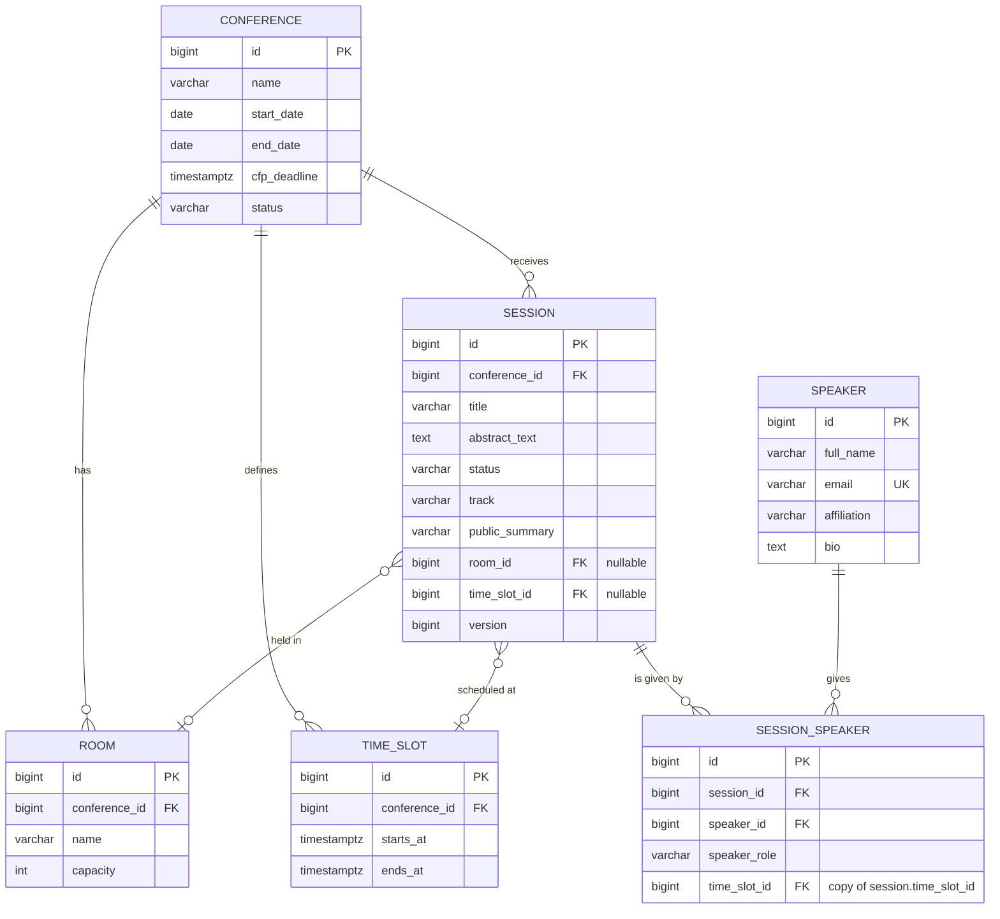

# Domain model

The schema is created by `src/main/resources/db/migration/V1__initial_schema.sql`.
This document describes it.

The parent-child aggregate is **Conference → Session**.

## Values

Each of these is a `CHECK` constraint in the database, so a misspelled value is rejected.

| Column | Values |
|---|---|
| `conference.status` | `DRAFT`, `CALL_OPEN`, `CALL_CLOSED`, `PUBLISHED`, `ARCHIVED` |
| `session.status` | `PROPOSED`, `ACCEPTED`, `REJECTED`, `SCHEDULED`, `CANCELLED` |
| `session_speaker.speaker_role` | `PRESENTER`, `CO_PRESENTER`, `MODERATOR` |

## Relations required by LO4

| Requirement | Where |
|---|---|
| One-to-many | `conference` → `session` |
| Many-to-many with attributes on the association | `session` ↔ `speaker` through `session_speaker`, which carries `speaker_role` |
| Optional relation | `session.room_id` and `session.time_slot_id`, both empty until the session is scheduled |

## Rules the database enforces

| Constraint | Meaning |
|---|---|
| `session_room_not_double_booked` | A room holds at most one session per slot |
| `speaker_not_double_booked` | A speaker gives at most one session per slot |
| `session_speaker_unique` | A speaker appears once per session |
| `session_scheduled_is_placed` | A `SCHEDULED` session must have both a room and a slot |
| `room_name_unique_per_conference` | Two rooms in one conference cannot share a name |
| `session.version` | Optimistic locking, so a lost update is detected |

Both double-booking rules are partial indexes, applying only where `time_slot_id` is set, so
any number of sessions may sit unscheduled. The reasoning behind modelling time this way is in
[ADR 0001](adr/0001-time-as-a-slot-grid.md).

## Known limitation

Nothing in the schema stops a session in one conference from referencing a room or a time slot
belonging to a different conference. Expressing that in SQL needs composite foreign keys, so it
is enforced in the service layer instead.

## Not in the schema yet

`registration` (room capacity and the waiting list), `ai_proposal` (the AI suggestion and its
review status) and `app_user` (security roles) arrive in later migrations, together with the
features that need them.
